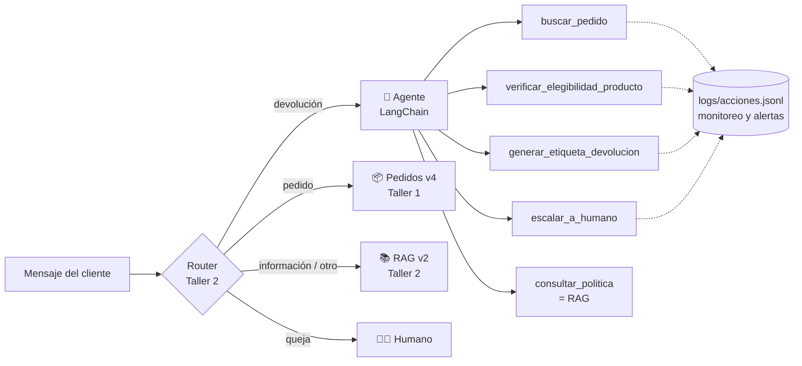

# EcoMarket: agente de IA para automatizar devoluciones

**Proyecto Final — IA Generativa**
Maestría en Inteligencia Artificial Aplicada

**Estudiante: Pedro Albeiro Jojoa Hernández**

Continuación de los talleres [#1 (ingeniería de prompts)](https://github.com/peteralbeiro09-hub/Taller-pr-ctico-1---G1-) y [#2 (RAG)](https://github.com/peteralbeiro09-hub/Taller-practico-2).

## El caso en tres líneas

En el Taller 2 el asistente de EcoMarket respondía cualquier consulta con RAG, pero ante una devolución solo podía **explicar** la política: el cliente seguía escribiendo a soporte y esperando hasta 2 días hábiles por la guía. En este proyecto la ruta de devoluciones pasa a un **agente** que **actúa**: consulta el pedido, verifica la elegibilidad del producto contra la política, genera la etiqueta de devolución y, si algo falla, abre un ticket para un humano. Todo se usa desde una **interfaz web en Streamlit**.

## Índice de las fases

| Fase | Documento | Contenido |
|---|---|---|
| 1. Arquitectura del agente | [docs/fase1_arquitectura_agente.md](docs/fase1_arquitectura_agente.md) | Router + agente con el RAG como herramienta; las 5 herramientas con sus entradas, salidas y errores; elección de LangChain; diagramas del flujo de devolución |
| 2. Implementación | [docs/fase2_implementacion.md](docs/fase2_implementacion.md) · [src/agente/](src/agente/) · [results/](results/) | Código por sección, manejo de éxito y error, evaluación del comportamiento, limitaciones y suposiciones |
| 3. Análisis crítico | [docs/fase3_analisis_critico.md](docs/fase3_analisis_critico.md) | 8 riesgos de dar acciones a la IA con su mitigación; monitoreo y alertas; propuestas de mejora |
| 4. Despliegue | [docs/fase4_despliegue.md](docs/fase4_despliegue.md) · [app_web.py](app_web.py) | Elección de Streamlit, la interfaz y el recorrido de la demostración |
| Video | [docs/guion_video.md](docs/guion_video.md) | Guion de la grabación (≤ 10 min) |

## Arquitectura



| Componente | Elección | Dónde |
|---|---|---|
| Marco de agentes | LangChain 1.x `create_agent` (ReAct sobre LangGraph), herramientas `StructuredTool` con esquemas Pydantic | `src/agente/agente.py` |
| LLM del agente | `openai/gpt-oss-120b` (pesos abiertos) vía Groq, con *tool calling* nativo; respaldo automático con `gpt-oss-20b` y `qwen3.8-27b` si se agota la cuota | `.env` → `AGENTE_MODEL`, `AGENTE_MODELOS_RESPALDO` |
| LLM del router, pedidos y RAG | `qwen/qwen3.8-27b` vía Groq: el mismo Qwen del Taller 1, con el que se validaron esos prompts | `.env` → `LLM_MODEL` |
| Herramientas | 4 funciones simuladas y deterministas + el RAG del Taller 2 | `src/agente/herramientas.py` |
| RAG | `multilingual-e5-small` + ChromaDB (Taller 2, sin cambios) | `src/rag.py`, `src/indice.py` |
| Validador de salida | Ningún RMA ni enlace llega al cliente si no existe en el registro de etiquetas emitidas | `src/agente/agente.py` |
| Observabilidad | Registro JSONL de cada acción, métricas y alertas | `src/agente/observabilidad.py` |
| Interfaz | Streamlit | `app_web.py` |

**Principio de diseño:** *el LLM decide qué hacer; el código decide qué está permitido.* Las reglas de la política de devoluciones están en Python, no en el prompt. `generar_etiqueta_devolucion` vuelve a verificar la elegibilidad aunque el agente se la salte, por ejemplo ante una inyección de prompt. A la salida, un validador bloquea cualquier dato de etiqueta inventado: un riesgo que se observó de verdad en la prueba de la interfaz ([Fase 3, R4](docs/fase3_analisis_critico.md#r4-datos-alucinados-presentados-como-reales)).

## Ejecución

Requisito: Python 3.11 o superior (probado con 3.13).

```bash
# 1. Clonar y entrar
git clone <url-de-este-repositorio>
cd <carpeta-del-repositorio>

# 2. Entorno virtual
python -m venv .venv
.venv\Scripts\activate          # Windows
# source .venv/bin/activate     # macOS / Linux

# 3. Dependencias (incluye PyTorch para los embeddings; la descarga es grande)
pip install -r requirements.txt

# 4. Pruebas de las herramientas, sin LLM ni clave
pytest

# 5. Base de conocimiento vectorial (la primera vez descarga el modelo de embeddings, ~470 MB)
python app.py indexar

# 6. Configurar el LLM: copiar .env.example como .env y pegar la clave de Groq en LLM_API_KEY
copy .env.example .env          # Windows  (cp .env.example .env en macOS / Linux)

# 7. Interfaz web
streamlit run app_web.py        # http://localhost:8501
```

**Clave de Groq (gratis, sin tarjeta):** entra a https://console.groq.com, inicia sesión con Google, GitHub o un correo, ve a **API Keys → Create API Key**, copia la clave (empieza por `gsk_` y solo se muestra una vez) y pégala en `LLM_API_KEY` dentro de `.env`. Los modelos de Groq cambian con el tiempo: si alguno deja de existir, `python app.py probar` lo indica y basta con cambiar `LLM_MODEL` o `AGENTE_MODEL`.

### Comandos

```bash
python app.py probar                               # Comprueba la conexión con el LLM
python app.py agente "Quiero devolver la botella del pedido ECO-10001, no la he usado"   # Solo el agente
python app.py chat                                 # Sistema completo en la terminal, con historial
python app.py evaluar-agente [--casos A1,A14]      # Casos de data/casos_agente.json → results/resultados_agente.md
python app.py monitoreo                            # Métricas y alertas de logs/acciones.jsonl
python app.py buscar "<texto>"                     # Solo recuperación RAG, sin LLM (Taller 2)
python app.py preguntar "<texto>"                  # Cadena RAG (Taller 2)
```

## Estructura del repositorio

```
├── README.md
├── docs/
│   ├── fase1_arquitectura_agente.md   Fase 1: arquitectura, herramientas, marco y flujo
│   ├── fase2_implementacion.md        Fase 2: código, manejo de errores, evaluación, limitaciones
│   ├── fase3_analisis_critico.md      Fase 3: riesgos, monitoreo, mejoras
│   ├── fase4_despliegue.md            Fase 4: Streamlit y demostración
│   ├── guion_video.md                 Guion del video
│   └── img/                           Capturas de la interfaz
├── src/
│   ├── agente/                        ★ Nuevo en el Proyecto Final
│   │   ├── herramientas.py            Las 5 herramientas (reglas de la política, etiquetas, tickets, RAG)
│   │   ├── agente.py                  Agente LangChain: modelo y respaldo, esquemas, límites, validador de salida
│   │   └── observabilidad.py          Registro de acciones, métricas y alertas
│   ├── cadena.py                      Router (Taller 2) con la ruta al agente y la ruta pegajosa
│   ├── rag.py, indice.py, ingesta.py  RAG del Taller 2
│   └── llm.py, config.py, prompts.py, contexto.py   Base de los Talleres 1 y 2
├── prompts/
│   ├── agente.toml                    ★ Prompt del agente y mensajes fijos de error
│   └── cadena.toml, rag.toml, pedidos.toml, devoluciones.toml   Talleres 1 y 2
├── data/                              Datos ficticios: pedidos, inventario, políticas, FAQ
│   └── casos_agente.json              ★ 19 casos de evaluación del agente
├── tests/test_herramientas.py         ★ 32 pruebas de las herramientas y del validador (sin LLM)
├── results/                           ★ Evidencia: respuestas reales del agente (versión final + 3 iteraciones)
├── app.py                             CLI
├── app_web.py                         ★ Interfaz Streamlit (.streamlit/config.toml)
├── requirements.txt
└── .env.example
```

Este repositorio contiene **solo el Proyecto Final**. Del código de los talleres anteriores se conserva lo que el agente reutiliza; sus documentos y resultados siguen en sus propios repositorios. Todos los datos (clientes, pedidos, precios, políticas, transportadoras, RMA y URL) son **ficticios**.
