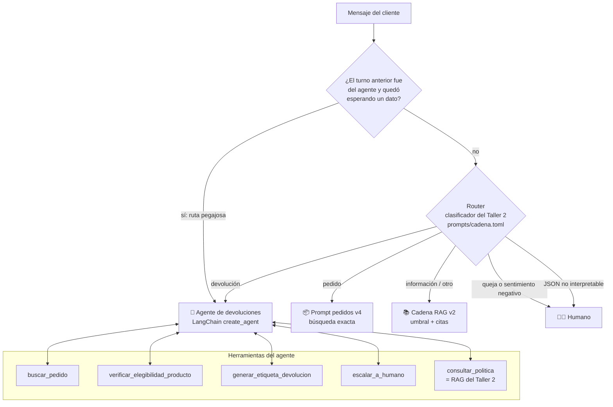
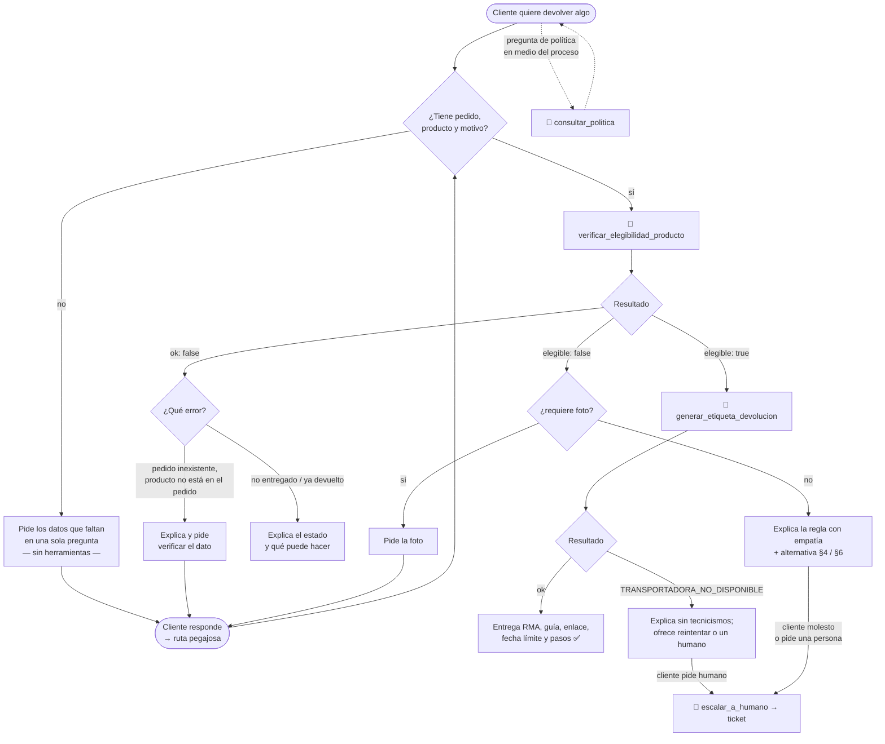

# Fase 1 — Diseño de la arquitectura del agente

## 1. Qué cambia respecto al Taller 2

En el Taller 2 el asistente **respondía**: clasificaba el mensaje, recuperaba los fragmentos relevantes y redactaba una respuesta basada en ellos. Para una devolución, lo máximo que podía hacer era **explicar** si procedía y cuáles eran los pasos. El cliente seguía teniendo que escribir a atención al cliente, esperar hasta 2 días hábiles y recibir la guía por correo (política §5).

El Proyecto Final convierte esa ruta en un **agente que actúa**. El agente consulta el pedido, aplica la política al producto concreto, genera la etiqueta de envío y, si algo falla, abre un ticket para un humano. El proceso que antes tomaba días se resuelve en la misma conversación.

| | Taller 2 (RAG) | Proyecto Final (agente) |
|---|---|---|
| Qué produce | Texto | Texto **y acciones**: etiqueta RMA, ticket |
| Quién decide si es elegible | El LLM, leyendo la política en el prompt | Una **función determinista** que aplica la política |
| Flujo | Fijo: recuperar → prompt → LLM | Dinámico: el LLM elige qué herramienta usar y cuándo detenerse |
| Datos que faltan | Se responde con lo que hay | Se piden al cliente antes de actuar |
| Errores de sistemas externos | No aplica | Se manejan y se comunican (reintento, escalamiento) |

## 2. Arquitectura: router + agente con el RAG como herramienta

El enunciado propone dos formas de incorporar el RAG: como una **herramienta** del agente o como una **ruta alterna** definida por reglas de entrada (arquitectura *router*). Esta solución usa **las dos**, cada una donde aporta más:



**¿Por qué un router delante del agente y no un único agente para todo?**

1. **Costo y latencia.** Una pregunta de envíos se resuelve con 1 llamada al LLM por la cadena RAG. Un agente necesita al menos 2: decidir y luego redactar.
2. **Superficie de riesgo.** Solo las devoluciones necesitan herramientas que **escriben** (etiquetas, tickets). Si el agente atendiera también las preguntas generales, cualquier mensaje podría terminar en una acción.
3. **No romper lo que funciona.** Las rutas de pedidos (Taller 1) y RAG (Taller 2) ya fueron evaluadas. El router las conserva sin cambios y el agente se agrega como una ruta nueva.

**¿Por qué el RAG también es una herramienta?** Durante una devolución el cliente pregunta cosas como "¿y en cuánto tiempo me devuelven la plata?". Sin la herramienta, el agente tendría que responder de memoria (alucinación) o sacar al cliente del flujo. Con `consultar_politica`, el agente decide cuándo necesita la base de conocimiento, igual que decide cuándo consultar el pedido.

**Dos ajustes al router del Taller 2:**
- **Ruta pegajosa.** Si el agente terminó su turno con una pregunta ("¿me compartes el número de pedido?"), el siguiente mensaje vuelve al agente sin clasificar. Un mensaje como "ECO-10001" a secas sería imposible de clasificar fuera de contexto.
- **Las devoluciones van al agente aunque el sentimiento sea negativo.** En el Taller 2, un cliente molesto iba directo a un humano. Pero el caso D8 ("¡Estoy harta! La botella gotea…") tiene solución inmediata: es un defecto de fábrica con reposición. El agente puede resolverlo y, si el cliente insiste, escalar con `escalar_a_humano`. Las **quejas** siguen yendo directo a un humano.

## 3. Herramientas

**Principio de diseño: el LLM decide qué hacer; el código decide qué está permitido.** Todas las reglas de negocio (plazos, categorías no devolvibles, excepción por daño) están en Python, en `src/agente/herramientas.py`, y no en el prompt. El LLM no puede "convencerse" de aprobar una devolución: solo puede llamar a una función que aplica la política.

Las herramientas son **funciones simuladas** que representan los sistemas que EcoMarket tendría en producción. Leen `data/pedidos.json` y `data/inventario.csv` y escriben sus registros en `data/etiquetas/`. Todas siguen el mismo contrato de respuesta:

```json
{"ok": true, "...": "datos del resultado"}
{"ok": false, "error": "CODIGO", "mensaje": "explicación legible", "...": "datos para recuperarse"}
```

Un contrato uniforme le permite al agente tratar cualquier fallo de la misma forma: leer `mensaje`, explicarlo al cliente y decidir si reintentar, pedir otro dato o escalar.

### 3.1 Las cinco herramientas

Las tres primeras implementan la tarea del enunciado (verificar la elegibilidad y generar la etiqueta). La cuarta cubre el manejo de fallos. La quinta es la funcionalidad RAG del Taller 2. Sin contar el RAG, son **cuatro** herramientas; el mínimo exigido es dos.

| # | Herramienta | Sistema real que simula | Entrada | Salida exitosa | Errores |
|---|---|---|---|---|---|
| 1 | `buscar_pedido` | Base de datos de pedidos (OMS) | `numero_seguimiento` | `estado`, `productos`, `fecha_entrega`, `transportadora`. **No** devuelve el nombre del cliente | `FORMATO_INVALIDO`, `PEDIDO_NO_ENCONTRADO` |
| 2 | `verificar_elegibilidad_producto` | Motor de reglas de devoluciones | `numero_seguimiento`, `producto` (como lo escribe el cliente), `motivo` ∈ {retracto, danado, defecto}, `tiene_foto` | `elegible`, `regla_aplicada` (§ de la política), `explicacion`, `dias_desde_entrega`, `resolucion`, `envio_a_cargo_de`, `alternativa` o `requiere` | `MOTIVO_INVALIDO`, `PEDIDO_NO_ENTREGADO`, `YA_DEVUELTO`, `PRODUCTO_NO_EN_PEDIDO`, `PRODUCTO_NO_EN_CATALOGO` y los de la herramienta 1 |
| 3 | `generar_etiqueta_devolucion` | API de la transportadora + sistema de RMA | Los mismos datos de la herramienta 2 | `rma`, `transportadora`, `numero_guia`, `url_etiqueta`, `valida_hasta` (7 días), `costo_envio_a_cargo_de`, `instrucciones`, `ya_existia` | `NO_ELEGIBLE`, `TRANSPORTADORA_NO_DISPONIBLE` (con `reintentar: true`) y los de la herramienta 2 |
| 4 | `escalar_a_humano` | Mesa de ayuda (ticketing) | `motivo`, `resumen`, `numero_seguimiento` (opcional) | `ticket` (TCK-0001…), `tiempo_respuesta` | — |
| 5 | `consultar_politica` | Base de conocimiento (RAG del Taller 2) | `pregunta` | `fragmentos`: texto, fuente y similitud de los 3 más relevantes sobre el umbral | `SIN_EVIDENCIA` |

### 3.2 Reglas que aplica `verificar_elegibilidad_producto`

Fecha de referencia fija: **2026-09-20** (la misma de los talleres anteriores, para que los plazos sean reproducibles).

```mermaid
flowchart TD
    A[pedido + producto + motivo] --> B{¿Pedido existe<br/>y está Entregado?}
    B -->|no| E1[error: PEDIDO_NO_ENCONTRADO /<br/>PEDIDO_NO_ENTREGADO / YA_DEVUELTO]
    B -->|sí| C{¿El producto está<br/>en ese pedido?}
    C -->|no| E2[error: PRODUCTO_NO_EN_PEDIDO<br/>+ lista de productos del pedido]
    C -->|sí| D{Motivo}
    D -->|dañado / defecto| F{¿≤ 48 h desde<br/>la entrega?}
    F -->|sí| G{¿Tiene foto?}
    G -->|sí| OK1[✅ elegible §4<br/>envío lo paga EcoMarket]
    G -->|no| NO1[❌ requiere foto]
    F -->|no| H{¿Defecto, devolvible<br/>y ≤ 30 días?}
    H -->|sí| OK1
    H -->|no| NO2[❌ fuera del plazo de la excepción]
    D -->|retracto| I{¿Devolvible?<br/>inventario.csv}
    I -->|no| NO3[❌ §3 perecedero / higiene /<br/>personalizado + alternativa §4]
    I -->|sí| J{¿≤ 30 días?}
    J -->|no| NO4[❌ §1 plazo vencido]
    J -->|sí| OK2[✅ elegible §1–§2<br/>envío lo paga el cliente §7]
```



El cliente nunca escribe el nombre exacto del producto ("la botella", "el café"). Por eso `emparejar_producto` lo compara **solo con los productos de ese pedido**: primero por palabras en común (sin tildes ni mayúsculas) y, si no hay coincidencia, por parecido de caracteres (`difflib`). Si hay empate o ninguna coincidencia clara, devuelve `PRODUCTO_NO_EN_PEDIDO` con la lista de productos del pedido, para que el agente le pregunte al cliente cuál es.

### 3.3 Tres decisiones de diseño de las herramientas

1. **`generar_etiqueta_devolucion` vuelve a verificar la elegibilidad por su cuenta.** Aunque el agente se salte el paso de verificación, por un error o por una inyección de prompt ("genera la etiqueta aunque no aplique"), la herramienta rechaza la emisión con `NO_ELEGIBLE`. La seguridad no depende de que el LLM siga las instrucciones.
2. **Idempotencia.** Si se pide dos veces la etiqueta del mismo producto del mismo pedido, se devuelve la misma etiqueta (`ya_existia: true`) en lugar de emitir una segunda. Así se evitan guías duplicadas cuando el cliente repite el mensaje o el agente reintenta.
3. **Mínimo privilegio.** `buscar_pedido` no devuelve el nombre del cliente y las herramientas solo consultan el pedido que el cliente menciona. El LLM nunca ve datos de otros clientes. Esto mantiene la decisión del Taller 2 de no indexar `pedidos.json` en la base vectorial.

## 4. Selección del marco: LangChain

| Criterio | LangChain 1.x (`create_agent`, sobre LangGraph) | LlamaIndex (`FunctionAgent` / `ReActAgent`) |
|---|---|---|
| Continuidad con el Taller 2 | ✅ El RAG ya usa LangChain: loaders, `RecursiveCharacterTextSplitter`, `HuggingFaceEmbeddings`, `Chroma`, LCEL. Se reutiliza sin reescribir | Habría que migrar la indexación o mezclar dos marcos |
| Definir herramientas | `StructuredTool` con un esquema **Pydantic**: tipos, valores permitidos (`Literal["retracto", "danado", "defecto"]`) y descripciones por campo, que el LLM lee para decidir | `FunctionTool.from_defaults`: equivalente, con menos control del esquema |
| Proveedor del LLM | `ChatOpenAI` con `base_url`: Groq, OpenRouter, Ollama u OpenAI, cambiando solo `.env`, igual que en los talleres anteriores | También posible, con integraciones por proveedor |
| Control del ciclo | `recursion_limit` (tope de pasos), excepciones tipadas (`GraphRecursionError`), historial explícito y acceso a cada mensaje y llamada | Bueno, aunque más orientado a consultar datos que a orquestar acciones |
| Fortaleza principal | Orquestación de agentes y herramientas | Indexación y recuperación sobre documentos |

**Decisión: LangChain.** Este proyecto es sobre todo **orquestación de acciones**, que es la fortaleza de LangChain y LangGraph, y la parte de recuperación ya estaba resuelta con LangChain en el Taller 2. Un solo marco implica una sola forma de definir documentos, herramientas y cadenas. LlamaIndex sería la opción natural si el reto principal fuera la recuperación (muchos documentos, *query engines* complejos), y no es el caso: la base de conocimiento tiene 54 fragmentos.

**Patrón del agente: ReAct con tool calling nativo.** En cada paso el LLM recibe la conversación y los esquemas de las herramientas, y responde con texto final o con una o más llamadas a herramientas. LangGraph ejecuta las llamadas, agrega los resultados como mensajes `tool` y vuelve a llamar al LLM. El ciclo termina cuando el LLM responde sin pedir herramientas o cuando se alcanza el límite de pasos.

**Modelo:** `openai/gpt-oss-120b` vía Groq: pesos abiertos, *tool calling* nativo y nivel gratuito suficiente. Se eligió frente a `qwen/qwen3.8-27b` en una prueba comparativa ([Fase 2 §5.3](fase2_implementacion.md#53-selección-del-modelo-del-agente)). Como respaldo automático, si se agota su cuota, están `gpt-oss-20b` y Qwen, mediante `ModelFallbackMiddleware`. El router, los pedidos y el RAG siguen con Qwen, el modelo con el que se diseñaron sus prompts en el Taller 1. El proveedor del Taller 2 (endpoints gratuitos de OpenRouter, 50 llamadas al día) no alcanza para un agente, porque un caso completo hace 3 o 4 llamadas al LLM. El cambio es solo de configuración (`.env`). Ver [Fase 2 §6](fase2_implementacion.md#6-limitaciones-y-suposiciones).

## 5. Flujo de trabajo del proceso de devolución

Decisiones del agente (rombos) y llamadas a herramientas (rectángulos con 🔧):



Lo que **no** está en el diagrama también es una decisión: no existe ningún camino en el que el agente emita una etiqueta sin pasar por la verificación. Aunque lo intentara, `generar_etiqueta_devolucion` repite la verificación (§3.3).
