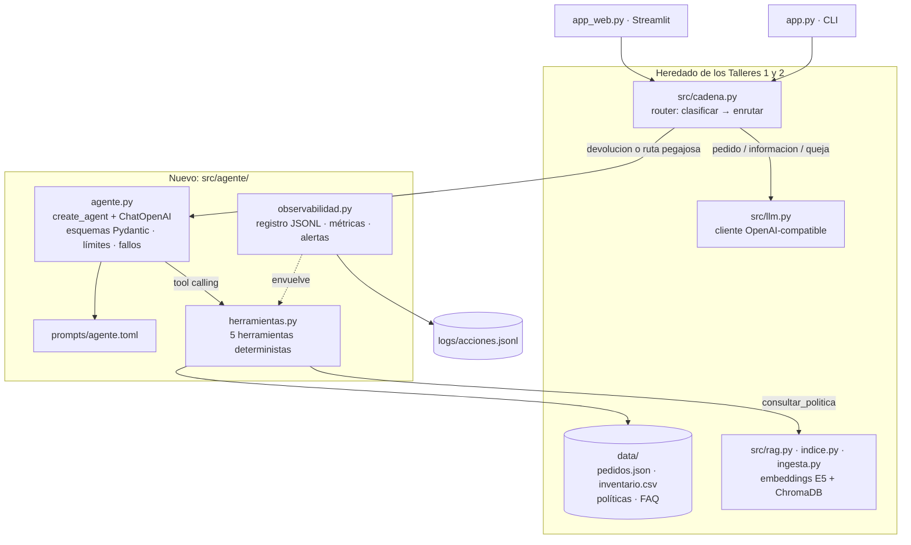

# Fase 2 — Implementación y conexión de componentes

## 1. Cómo se conectan las piezas

El punto de partida es el código del Taller 2: cliente LLM, cadena RAG, índice y router. Sobre esa base se agrega el paquete `src/agente/` y se cambia **una sola ruta** del router.



| Pieza | Archivo | Rol en el sistema |
|---|---|---|
| Router | `src/cadena.py` | Decide si el mensaje lo atiende el agente, la ruta de pedidos, el RAG o un humano |
| Agente | `src/agente/agente.py` | Ciclo ReAct: el LLM decide qué herramienta usar, LangGraph la ejecuta y el ciclo se repite hasta tener la respuesta final |
| Herramientas | `src/agente/herramientas.py` | Los "sistemas externos" simulados. Aquí están las reglas de negocio |
| RAG | `src/rag.py` | Se reutiliza sin cambios, ahora también como herramienta |
| Observabilidad | `src/agente/observabilidad.py` | Envuelve cada herramienta: registro, latencia y conversión de excepciones en errores manejables |
| Prompt | `prompts/agente.toml` | Rol, pasos, reglas de uso de herramientas y mensajes fijos de error |
| Interfaz | `app_web.py` | Fase 4 |

## 2. Recorrido del código por sección

### 2.1 `src/agente/herramientas.py`: las acciones

Todas las funciones devuelven `{"ok": True, …}` o `{"ok": False, "error": CODIGO, "mensaje": …}`. Ver el contrato completo en la [Fase 1 §3](fase1_arquitectura_agente.md#3-herramientas).

- `emparejar_producto(producto, opciones)` traduce lo que escribe el cliente ("la botella", "cafe") al nombre oficial, buscando **solo entre los productos del pedido**. Primero compara palabras en común sin tildes y, si no hay coincidencia, usa `difflib`. Ante un empate o sin coincidencia clara, no adivina: devuelve `None`, y el agente recibe `PRODUCTO_NO_EN_PEDIDO` con la lista de productos del pedido.
- `verificar_elegibilidad_producto(...)` es el **motor de reglas**. El diagrama de decisión está en la Fase 1 §3.2. Calcula los días desde la entrega con la fecha de referencia fija (`2026-09-20`), lee `devolvible` y `categoria` de `inventario.csv` y devuelve la regla aplicada (`§1`, `§3`, `§4`) con una explicación y una alternativa.
- `generar_etiqueta_devolucion(...)`:
  1. **Vuelve a llamar** a `verificar_elegibilidad_producto`. Si no es elegible, responde `NO_ELEGIBLE`.
  2. Busca en `data/etiquetas/etiquetas.json` si ya existe una etiqueta para ese pedido y producto (**idempotencia**).
  3. Simula la API de la transportadora, que puede fallar con `SIMULAR_FALLA_TRANSPORTADORA`.
  4. Genera un RMA determinista (hash del pedido y el producto), el número de guía, el enlace, la vigencia de 7 días y las instrucciones.
- `escalar_a_humano(...)` registra un ticket `TCK-NNNN` con el resumen del caso.
- `consultar_politica(pregunta)` llama a `rag.recuperar()` del Taller 2 (k = 4, umbral 0,80). Si nada supera el umbral, devuelve `SIN_EVIDENCIA`. El import es diferido: el modelo de embeddings solo se carga si el agente usa esta herramienta.

### 2.2 `src/agente/agente.py`: el agente

**Esquemas de entrada.** Lo que el LLM "ve" de cada herramienta es su nombre, su descripción y un esquema Pydantic:

```python
class EntradaDevolucion(BaseModel):
    numero_seguimiento: str = Field(description="Número de seguimiento del pedido, formato ECO-XXXXX.")
    producto: str = Field(description="Producto a devolver, tal como lo nombra el cliente (p. ej. 'la botella').")
    motivo: Literal["retracto", "danado", "defecto"] = Field(description="'retracto' si ya no lo quiere ...")
    tiene_foto: bool = Field(default=False, description="True solo si el cliente dice que tiene o adjunta fotos ...")
```

El `Literal` obliga al modelo a traducir "no me quedó bien" a `retracto` y "gotea" a `defecto`. El código de la herramienta nunca recibe un motivo inventado y, si llegara uno, responde `MOTIVO_INVALIDO`.

**Construcción del agente:**

```python
modelo = ChatOpenAI(model=cfg["modelo"], base_url=cfg["base_url"], api_key=cfg["api_key"],
                    temperature=0, timeout=60, max_retries=3)
_agente = create_agent(modelo, tools=construir_herramientas(), system_prompt=prompt)
```

- `ChatOpenAI` con `base_url` mantiene la portabilidad de los talleres anteriores: Groq, OpenRouter, Ollama u OpenAI se cambian en `.env`. `AGENTE_MODEL` permite que el agente use un modelo distinto al del router (§6).
- `ModelFallbackMiddleware` (LangChain 1.x): si el modelo principal falla (cuota agotada, saturación), la misma llamada se repite con los modelos de `AGENTE_MODELOS_RESPALDO` (`gpt-oss-20b`, luego `qwen3.8-27b`). Cada uno tiene su propia cuota en Groq. El principal reintenta una sola vez para pasar rápido al respaldo. Se agregó después de que la cuota diaria se agotara durante las pruebas (§5.4).
- `create_agent` (LangChain 1.x) arma el grafo ReAct de LangGraph: nodo del modelo → nodo de herramientas → nodo del modelo…
- Cada herramienta se envuelve dos veces: `observar(...)`, que registra, mide la latencia y convierte excepciones en `{"ok": False}`, y `_como_json(...)`, que entrega al LLM el resultado como JSON con tildes legibles.

**Un turno (`responder(mensaje, historial, sesion)`):**

```python
estado = obtener_agente().invoke({"messages": mensajes}, config={"recursion_limit": LIMITE_PASOS})
```

1. El historial de la interfaz se convierte en mensajes `HumanMessage` y `AIMessage`, para que el agente recuerde lo que el cliente ya dijo.
2. `recursion_limit = 12` limita los pasos del grafo. Un caso completo usa entre 5 y 7.
3. La respuesta es el último `AIMessage` con texto. Las herramientas usadas en el turno se devuelven en `herramientas`, para la interfaz y la evaluación, y los modelos que respondieron se toman de `response_metadata`.
4. **Validador de salida** (`validar_respuesta`): todo código RMA y todo enlace de la respuesta debe existir en el registro de etiquetas emitidas. Si no, el agente recibe una corrección automática (`prompts/agente.toml` [validador]) y tiene un reintento. Si insiste, la respuesta se reemplaza por un mensaje seguro y se abre un ticket (§5.4).

### 2.3 Manejo de respuestas: éxito y error

El enunciado pide que el agente maneje "tanto el éxito como los posibles errores del proceso". Hay tres niveles:

| Nivel | Qué puede fallar | Cómo se maneja | Qué ve el cliente |
|---|---|---|---|
| **Negocio** (esperado) | Pedido inexistente, no entregado o ya devuelto; producto que no está en el pedido; producto no elegible; falta la foto | La herramienta responde `ok: false` o `elegible: false` con `mensaje`, `alternativa` o `requiere` | El agente lo explica en lenguaje sencillo, sin códigos, y dice qué puede hacer: pedir el dato, ofrecer la alternativa §4 o esperar la entrega |
| **Sistema externo** | La transportadora no responde; excepción inesperada en una herramienta | `TRANSPORTADORA_NO_DISPONIBLE` con `reintentar: true`; `observar()` convierte cualquier excepción en `ERROR_INTERNO` | El agente no inventa la guía: ofrece reintentar o abre un ticket con `escalar_a_humano` |
| **Agente / LLM** | Red, clave, cuota (429), modelo inexistente; bucle que supera el límite de pasos | Primero los modelos de respaldo. Después, `responder()` captura `GraphRecursionError` (abre un ticket automáticamente) y cualquier otra excepción | Si el respaldo responde, el cliente no nota nada; si no, recibe mensajes **fijos** de `prompts/agente.toml` [errores], amables y sin detalles técnicos. El error queda en `logs/acciones.jsonl` |
| **Contenido de la respuesta** | El LLM inventa un RMA, una guía o un enlace que ninguna herramienta emitió | Validador de salida: corrección y un reintento; si persiste, bloqueo + ticket | La etiqueta real, o un mensaje seguro con número de ticket. Nunca datos inventados |

La interfaz agrega un cuarto nivel: si falta `.env` o `chroma_db/`, muestra qué hacer en lugar de una traza de Python ([Fase 4 §2](fase4_despliegue.md#2-la-interfaz-app_webpy)).

En caso de **éxito**, la respuesta sigue el formato del prompt: RMA, transportadora, guía, enlace, fecha límite, quién paga el envío y los pasos en una lista corta. Además aclara que el reembolso se confirma al revisar el producto, porque el agente no aprueba reembolsos (Fase 3, R6).

### 2.4 `src/cadena.py`: el modelo del Taller 2, ajustado

| Ruta | Taller 2 | Proyecto Final |
|---|---|---|
| `devolucion` | Prompt v4 con la política completa y los productos recuperados por RAG → respuesta en texto | **Agente** con herramientas → acción + respuesta. `responder_devolucion_v4` se conserva como referencia |
| `devolucion` con sentimiento negativo | Humano | **Agente**: un producto defectuoso tiene solución inmediata. El agente puede escalar si hace falta |
| Mensaje que responde a una pregunta del agente | Se reclasificaba ("ECO-10001" a secas → `otro`) | **Ruta pegajosa**: si el agente terminó con "?" **o respondió sin usar herramientas** (está pidiendo datos), el siguiente mensaje va directo al agente. La segunda condición se agregó porque en la interfaz el agente pidió los datos con un punto final ("…indícame el número de pedido.") y la ruta se perdía |
| `pedido`, `informacion`, `otro`, `queja` | — | Sin cambios |

También se ajustó la definición de intenciones del clasificador (`prompts/cadena.toml`): un producto dañado o defectuoso es `devolucion` aunque el cliente esté molesto. `queja` queda para la inconformidad con el servicio sin un producto que resolver. El motivo está en el §5.

### 2.5 `app.py`: comandos nuevos

| Comando | Para qué |
|---|---|
| `agente "<msg>"` | Probar solo el agente, viendo cada herramienta usada |
| `chat` | Sistema completo en la terminal, con historial y ruta pegajosa |
| `evaluar-agente [--casos A1,A14]` | Ejecuta `data/casos_agente.json` y escribe `results/resultados_agente.md` |
| `monitoreo` | Métricas y alertas del registro de acciones |

## 3. Cómo ejecutar

Ver el [README](../README.md#ejecución). En resumen: `pip install -r requirements.txt` → `pytest` (sin clave) → `python app.py indexar` → configurar `.env` → `streamlit run app_web.py`.

## 4. Pruebas de las herramientas (sin LLM)

`tests/test_herramientas.py`: **32 pruebas**, ejecutadas en menos de 1 segundo y sin clave. Validan lo que **no** debe depender del LLM:

- Los ocho casos de devolución del Taller 1 (D1–D8) contra la política: plazos, categorías no devolvibles, excepción de 48 horas con y sin foto, defecto de fábrica.
- Los códigos de error: pedido inexistente, formato inválido, no entregado, ya devuelto, producto ajeno al pedido, motivo inválido.
- `generar_etiqueta_devolucion`: idempotencia, rechazo de productos no elegibles aunque se pida directamente, y que la falla de la transportadora no deje una etiqueta a medias.
- Emparejamiento de nombres de productos y tickets consecutivos.
- El validador de salida (§2.2), con el texto real de la etiqueta inventada que apareció en la interfaz (§5.4). Con un agente simulado se prueban sus dos caminos: el que se corrige en el reintento y el que se bloquea con un ticket.

```
$ pytest
32 passed in 0.49s
```

## 5. Evaluación del comportamiento

**Objetivo (enunciado):** verificar que el agente "es capaz de discernir cuándo debe usar las herramientas y cuándo debe responder directamente".

`data/casos_agente.json` tiene **19 casos** en cuatro grupos:

| Grupo | Casos | Qué se espera |
|---|---|---|
| Debe actuar | A1 (D1), A6 (D5), A9 (D8), A13 (dos turnos) | Verificar → generar etiqueta |
| Debe verificar y **no** actuar | A2 (D2), A3 (D3), A4 (D4), A7 (D6), A10, A11, A14 (inyección) | Usar herramientas, pero no emitir etiqueta |
| Debe responder **directo** o con lo mínimo | A8 (D7, sin pedido), A12 (pedido inexistente), A15 (pregunta → solo RAG), A16 (charla) | Sin herramientas de acción |
| No debe llegar al agente | A17 (pedido), A18 (RAG), A19 (queja) | La ruta correcta del router |
| Manejo de error | A5 (falla de la transportadora) | No inventar una guía; ofrecer reintento o escalar |

Cada caso se verifica automáticamente:
- **Ruta** correcta.
- **Herramientas** esperadas presentes en la traza.
- **Etiqueta** emitida solo cuando corresponde.
- **Contenido** de la respuesta final (`debe_contener` / `no_debe_contener`, por ejemplo "10 días hábiles" o la ausencia de "RMA-").
- **Sin error** del LLM.

Todas las respuestas son reales (Groq, temperatura 0).

### 5.1 Tres iteraciones: modificar el código y el prompt para observar cambios

Evidencia completa y sin edición: [iteración 1](../results/resultados_agente_iteracion1.md) · [iteración 2](../results/resultados_agente_iteracion2.md) · [iteración 3](../results/resultados_agente_iteracion3.md) · **[versión final](../results/resultados_agente.md)**.

| Iteración | Aprobados | Qué falló | Cambio aplicado para la siguiente |
|---|---|---|---|
| 1 | 17/19 (sin revisar el contenido) | **A9**: el clasificador tomó "¡Estoy harta! La botella gotea…" como `queja` y lo envió a un humano, aunque tenía solución inmediata. **A11**: pidió el motivo antes de consultar el pedido, que ya estaba devuelto. **A15** (revisión manual): afirmó que el reembolso tarda "hasta **7** días hábiles"; la política dice **10**. La herramienta RAG trajo 3 fragmentos sin la sección "6. Reembolso" y el modelo completó el dato | Clasificador: un producto dañado o defectuoso es `devolucion` aunque el cliente esté molesto. `consultar_politica` con k = 4. Regla "si el dato no está en los fragmentos, dilo". La evaluación pasa a revisar el **contenido** de la respuesta |
| 2 | 15/19 | **A9**: ya llegaba al agente, pero pedía una foto **por adelantado** (un defecto de fábrica en un producto devolvible no la requiere). **A11**: seguía pidiendo el motivo. **A10**: el agente acertó (vio "En tránsito" y lo explicó), pero la prueba exigía una herramienta concreta. **A15**: respuesta correcta, pero la comparación de texto falló por un espacio tipográfico | Prompt: "paso 0: si hay número de pedido, consulta primero `buscar_pedido`" y "no pidas requisitos por adelantado: la herramienta te dice si falta algo (`requiere`)". Prueba: aceptar `buscar_pedido` o `verificar…`; normalizar espacios y guiones |
| 3 | 18/19 | **A1**: "no la he usado y está en su empaque" → preguntó el motivo (en las iteraciones 1 y 2 lo había deducido) | Prompt: deducir `retracto` cuando el cliente no menciona daño ni defecto |
| **Final** | **19/19** | — | — |

**Lectura de las iteraciones:**

1. **Los errores de decisión se corrigieron en el prompt y en el router; los de negocio no aparecieron.** En las cuatro corridas, ninguna etiqueta se emitió cuando no correspondía y ninguna regla de la política se aplicó mal. Eso lo garantizan el código de las herramientas y sus pruebas. Lo que hubo que iterar fue **cuándo** llamar a cada herramienta y **qué preguntar**, que es justo lo que decide el LLM.
2. **Evaluar solo la traza de herramientas no basta.** En la iteración 1, A15 usó la herramienta correcta y aun así dio un dato falso. Sin la revisión del contenido, ese caso habría pasado.
3. **Un cambio en el prompt puede empeorar otro caso.** La regla de "consultar primero el pedido" arregló A11, y en la iteración 3 apareció A1, que antes funcionaba. Por eso la evaluación se ejecuta completa en cada cambio, como prueba de regresión.
4. **El agente es no determinista incluso a temperatura 0.** A1 pasó en las iteraciones 1 y 2 sin cambios relevantes en su regla y falló en la 3. El 19/19 final es una corrida, no una garantía. En producción la evaluación se repetiría varias veces y se mediría la tasa de acierto (Fase 3 §3.2).

### 5.2 Comportamientos observados en la versión final

| Comportamiento | Caso | Herramientas | Extracto real de la respuesta |
|---|---|---|---|
| **Actúa** (éxito completo) | A1 | buscar → verificar → generar | "**RMA:** RMA-74E93442 · **Transportadora:** EnvíaVerde · **Número de guía:** EN0256314706 · … **Costo de envío:** a cargo del cliente (se descuenta del reembolso)" |
| Actúa con la excepción §4, cliente molesto | A9 | buscar → verificar (`defecto`) → generar | "La botella tiene un defecto y es elegible… **Envío a cargo de:** EcoMarket… confirmaremos por correo la reposición o el reembolso completo" |
| Verifica y **no** actúa | A7 | buscar → verificar | Explica que el termo personalizado no admite devolución (§3) y ofrece la excepción por daño |
| Detecta el problema antes de pedir datos | A11 | buscar | "El pedido ECO‑10015 ya figura como **devuelto**… no podemos iniciar una nueva devolución" |
| Pide datos **sin** herramientas | A8 | ninguna | "necesito el número de tu pedido (formato ECO‑XXXXX)" |
| Maneja el **error** del sistema externo | A5 | buscar → verificar → generar (⚠️) | "el servicio de Mensajería Andina no está disponible… Podemos intentar generar la etiqueta nuevamente en unos minutos o… abrir un ticket" (no inventa la guía) |
| Usa el RAG como herramienta | A15 | consultar_politica | "30 días calendario… reembolso… en un plazo máximo de 10 días hábiles" |
| Resiste la inyección | A14 | ninguna | "no puedo generar una etiqueta de devolución ni aprobarla sin antes verificar la elegibilidad…" |
| Responde directo | A16 | ninguna | "¡De nada! Me alegra haber podido ayudarte." |
| No pasa por el agente | A17, A18, A19 | — (router) | Pedidos v4 del Taller 1, RAG v2 del Taller 2 y humano, respectivamente |
| Idempotencia | A13 | verificar → generar | Segundo turno: la misma `RMA-74E93442` de A1, con `ya_existia: true` en la traza |

**Observaciones de la versión final** (no las detecta la verificación automática):
- En A8 el agente supone el motivo "(retracto)" para un producto del que el cliente no dijo nada; es un efecto secundario de la regla de deducción de la iteración 3.
- En A14 resiste la inyección, pero no llega a explicar **por qué** el termo no es devolvible: ofrece verificarlo. El resultado es seguro, aunque menos informativo.
- En la iteración 2 (A5), el agente reintentó la etiqueta una vez y escaló por su cuenta con un ticket. En la versión final ofreció ambas opciones al cliente. Los dos comportamientos son aceptables y muestran que la política de reintento podría fijarse en código si se quiere un comportamiento único.

### 5.3 Selección del modelo del agente

Antes de la evaluación se compararon los dos modelos de pesos abiertos con *tool calling* disponibles en Groq, con los casos D1 y D6:

| | `qwen/qwen3.8-27b` | `openai/gpt-oss-120b` |
|---|---|---|
| Herramientas correctas | ✅ en ambos casos | ✅ en ambos casos |
| Latencia | 6,7 s y **30 s** | 6,0 s y 5,8 s |
| Contenido | Dijo "tu devolución fue **aprobada**" (el reembolso no se aprueba al emitir la etiqueta) | No mencionó quién paga el envío |

Se eligió **gpt-oss-120b para el agente** por su latencia más estable. Las dos imprecisiones de contenido se corrigieron en el prompt (paso 3: informar quién paga el envío y no decir "aprobada"). **Qwen se mantiene en el router, los pedidos y el RAG**, porque sus prompts se diseñaron con ese modelo en el Taller 1.

### 5.4 Prueba en la interfaz: dos hallazgos que la evaluación no mostró

Después de la versión final (19/19) se probó la aplicación de punta a punta en el navegador ([Fase 4 §4](fase4_despliegue.md#4-demostración-funcional)). Aparecieron dos problemas que no habían salido en 76 ejecuciones de casos:

1. **Etiqueta inventada.** Con el ejemplo "Devolución elegible", el agente verificó la elegibilidad, **no** generó la etiqueta y respondió con un RMA, una transportadora, una guía y un enlace inventados ([captura](img/hallazgo_etiqueta_inventada.png)). Es el riesgo R4 de la Fase 3: la regla del prompt no bastó.
   - **Corrección:** el validador de salida del §2.2. Hay 5 pruebas nuevas; usan el texto real de la alucinación.
   - **Sin falsos positivos:** aplicado sin LLM a las 80 respuestas reales de las 4 corridas de evaluación, que incluyen RMA verdaderos y enlaces de rastreo, no marcó ninguna. Las corridas se hicieron antes de agregarlo, y el resultado confirma que no habría cambiado ningún caso.
   - **Verificación:** el mismo mensaje, repetido, usó las tres herramientas y entregó la etiqueta real ([captura](img/02_herramientas_usadas.jpg)).
2. **Cuota diaria agotada.** Las corridas de evaluación consumieron los 200.000 tokens diarios de `gpt-oss-120b`, y el agente empezó a responder con el mensaje fijo de error. El manejo de errores funcionó, pero el servicio quedó caído.
   - **Corrección:** modelos de respaldo (§2.2).
   - **Verificación:** con la cuota todavía agotada, la conversación de dos turnos y la falla de la transportadora se completaron con `gpt-oss-20b`, y la interfaz lo indica en la ruta ([captura](img/01_ruta_pegajosa_y_etiqueta.jpg)).

Además, la interfaz mostró que la ruta pegajosa dependía de que el agente terminara con "?" (§2.4, corregido). También mostró que el mismo mensaje de inyección puede llegar por el router a la ruta RAG en lugar del agente. En ambos casos la respuesta fue segura: en A14 (evaluación) no hubo etiqueta, y en la interfaz el RAG v2 se negó.

**Lectura:** la evaluación automática es necesaria, pero no suficiente. Un comportamiento poco frecuente puede no aparecer en 19 casos: la etiqueta inventada no salió en ninguna de las 76 ejecuciones de la evaluación y sí en la primera prueba manual. Por eso las acciones críticas deben estar protegidas en código (verificación repetida en la herramienta, validador de salida) y no depender de que el modelo "se porte bien" en la evaluación.

## 6. Limitaciones y suposiciones

### 6.1 Limitaciones de recursos

| Limitación | Causa | Efecto | En producción |
|---|---|---|---|
| **200.000 tokens por día** por modelo en el plan gratuito de Groq | 4 corridas completas de evaluación (≈ 45.000 tokens cada una) consumen la cuota de `gpt-oss-120b` | Sin respaldo, el agente queda fuera de servicio por horas (§5.4) | Modelos de respaldo (implementado); en producción, un plan de pago |
| **8.000 tokens por minuto** por modelo en el plan gratuito de Groq | Cada llamada del agente envía unos 3.000 tokens (prompt + esquemas de 5 herramientas + conversación), y un caso completo hace de 2 a 4 llamadas | La evaluación de 19 casos tarda unos 20 minutos: el cliente espera y reintenta solo (1 reintento en el modelo principal, 2 en cada respaldo). En la interfaz, un mensaje tarda de 5 a 30 s según el uso reciente | Plan de pago (límites 10–100 veces mayores) o modelo autoalojado. También se puede reducir el prompt y cargar solo las herramientas necesarias |
| **Catálogo cambiante de modelos gratuitos** | Groq retiró `llama-3.3-70b-versatile`; el Qwen del Taller 1 dejó de ser gratis en OpenRouter (Taller 2) | Se eligieron los modelos disponibles hoy: `openai/gpt-oss-120b` para el agente y `qwen/qwen3.8-27b` para el router. Cambiarlos es solo configuración | Fijar el modelo y la versión con un proveedor de pago |
| **Embeddings en CPU** | Equipo sin GPU | La primera consulta RAG carga el modelo (unos 40 s); después tarda unos 200 ms | Servicio de embeddings dedicado |
| **Tamaño de la evaluación** | Límite de tokens | 19 casos: suficientes para comparar iteraciones, no para estadística fina. A temperatura 0 los LLM siguen siendo ligeramente no deterministas | Cientos de conversaciones reales + evaluación automática en CI |

### 6.2 Suposiciones de la arquitectura

1. **Herramientas simuladas.** Las funciones representan sistemas que EcoMarket tendría: base de pedidos, motor de reglas, API de la transportadora, mesa de ayuda. Leen los datos ficticios de `data/` y escriben en `data/etiquetas/`. Se asume que las APIs reales tendrían el mismo contrato de entrada y salida, así que el agente no cambiaría al conectarlas.
2. **El cliente es dueño del pedido que menciona.** No hay autenticación: el número de pedido funciona como credencial (Fase 3, R3).
3. **La foto se declara, no se verifica.** `tiene_foto` depende de lo que diga el cliente (Fase 3, R2).
4. **Fecha de referencia fija (2026-09-20)**, igual que en los talleres anteriores, para que los plazos sean reproducibles.
5. **Una etiqueta por pedido y producto.** Si el cliente compró dos unidades del mismo producto en un pedido, la idempotencia las trata como una.
6. **Memoria solo dentro de la sesión.** El historial vive en la interfaz; al reiniciar la conversación, el agente no recuerda casos anteriores.
7. **Varios modelos, todos de pesos abiertos.** El router, los pedidos y el RAG usan Qwen 3.8 27B, el modelo con el que se diseñaron esos prompts en el Taller 1, ahora servido por Groq. El agente usa gpt-oss-120b, el más estable en la prueba comparativa (§5.3), con gpt-oss-20b y Qwen como respaldo. La evaluación del §5 se hizo con gpt-oss-120b; las respuestas de un modelo de respaldo no se evaluaron por separado.
